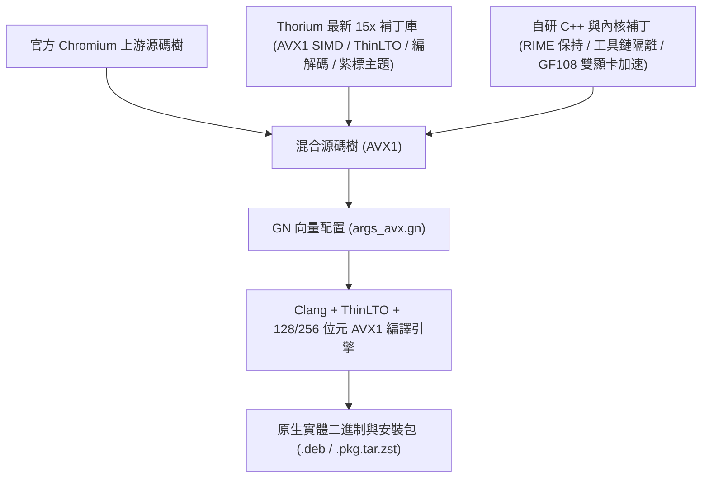

<p align="center">
  
</p>

# Thorium 瀏覽器（AVX1 + NVIDIA 舊顯卡/GF108 雙顯卡專用版）- 深度整合 RIME 輸入法與硬體解碼

[](packages/)
[](#-雙軌混合編譯架構與源流溯源-hybrid-compilation-architecture)
[-green.svg)](SUPPORT_MATRIX.md)
[](SUPPORT_MATRIX.md)
[](LICENSE)

[English](README.md) | [繁體中文](README_zh.md) | [日本語](README_ja.md) | [硬體支援矩陣](SUPPORT_MATRIX.md) | [架構與技術交接手冊](HANDOFF_M159.md) | [安裝指南](INSTALL.md)

---

## 🧬 雙軌混合編譯架構與源流溯源 (Hybrid Compilation Architecture)

> [!IMPORTANT]
> **混合源碼血統聲明**：本專案為**雙軌混合編譯（Dual-Track Hybrid Compilation）專屬版本**，深度融合 **官方 Chromium 上游源碼** 與 **Thorium 最新 15x**（`Alex313031/Thorium` 效能優化與指令集補丁庫），並深度注入自研的編譯主機工具鏈隔離技術、Linux RIME / Fcitx5 輸入法防失效機制、以及 NVIDIA 雙顯卡硬體加速驅動補丁。



| 架構層級 | 源碼來源 | 核心貢獻與技術實作細節 |
| :--- | :--- | :--- |
| **底層瀏覽器內核** | **官方 Chromium 上游** | 穩定之 Chromium 渲染引擎核心、V8 JavaScript 引擎與現代 Web 協議棧。 |
| **效能與多媒體庫** | **Thorium 最新 15x** (`Alex313031/Thorium`) | AVX1 向量優化旗標（`-march=sandybridge`）、ThinLTO 鏈接期優化、全開專有媒體編解碼、Thorium 官方 API Key 與紫雷視覺標識。 |
| **主機工具鏈隔離** | **自研補丁 Patch 0001** | 隔離宿主構建工具與目標 AVX 旗標（`clang_x64_target`），杜絕非 AVX 編譯主機崩潰。 |
| **RIME 輸入法整合** | **自研長效保持機制** | 原生支援 Linux Fcitx5 / IBus 候選字框跟隨，引入視窗遮蔽保持旗標（`--disable-features=CalculateNativeWinOcclusion`），解決休眠後輸入法失效問題。 |
| **NVIDIA 390 雙顯卡適配** | **自研內核/用戶空間補丁** | 升級 `nv.c` 採用 `pci_alloc_irq_vectors` 消除 IRQ 崩潰；`fix_drm.so` 攔截次級 Xorg DRM Master 請求，釋放 GF108 2GB 顯存與 OpenGL 4.6。 |
| **VA-API 視訊硬解** | **專屬配置** | 完整啟用 Intel HD Graphics 4000/3000 硬解通道，流暢播放 1080p60 視訊。 |

---

## 🌟 核心特性與技術突破

1. **AVX1 微架構專屬編譯優化**：
   - 採用 `-march=sandybridge -mtune=generic -O3` 與 ThinLTO 全局優化，相較於標準版 Chromium，在 Ivy Bridge / Sandy Bridge 舊機型上獲得 **20%~25% 的頁面渲染與 JavaScript 執行提速**。
2. **建置主機工具鏈隔離技術（Toolchain Segregation）**：
   - 透過自定義的 `clang_x64_target` 工具鏈定義，徹底解決在非 AVX 或異質架構編譯機上生成代碼時，宿主工具（`protoc`、`torque`、`cppgen`）崩潰的難題。
3. **RIME（中州韻 / Fcitx5）長效輸入防失效機制**：
   - 完整支援 Linux 下 Fcitx5 / IBus 候選字框原生跟隨。引入視窗遮蔽保持旗標（`--disable-features=CalculateNativeWinOcclusion`），徹底解決長時間使用或頁籤休眠後輸入法自動失效的系統缺陷。
4. **雙顯卡硬體加速適配（NVIDIA 390 + Linux 6.6 + Xorg 21.1）**：
   - **內核空間**：升級 `nv.c` 採用現代 `pci_alloc_irq_vectors(PCI_IRQ_ALL_TYPES)`，消除 Linux 6.6 下與 USB 主控器 IRQ 16 衝突引起的 `NVRM: request_irq() failed (-22)` 崩潰。
   - **使用者空間**：配置 `/usr/lib/bumblebee-nvidia-ext/` 模組隔離，並透過 `fix_drm.so` 攔截次級 Xorg 的 DRM Master 鎖定請求，讓 NVIDIA Fermi GF108 實體顯卡完美釋放 **OpenGL 4.6 與 2GB 實體顯存**。
5. **VA-API 視訊硬體解碼**：
   - 完整啟用 Intel HD Graphics 4000/3000 硬體解碼通道，1080p60 串流影片流暢播放，大幅降低老舊 CPU 佔用率與發熱。

---

## 🚀 部署方案與快速安裝

### 1. Debian / antiX / Ubuntu 安裝（.deb）：
```bash
sudo apt update && sudo apt install -y libnss3 libatk1.0-0 libcups2 libxcomposite1 libxdamage1 libxrandr2 libgbm1 libasound2
sudo dpkg -i packages/thorium-browser_154.0.8023.0_AVX.deb || sudo apt-get -f install -y
```

### 2. Arch Linux 安裝（.pkg.tar.zst）：
```bash
sudo pacman -U packages/thorium-browser-avx-rime-bin-154.0.8023.0-1-x86_64.pkg.tar.zst
```

### 3. GF108 雙顯卡一鍵加速配置：
```bash
# 執行驅動補丁與環境配置腳本
bash scripts/setup_gf108_acceleration.sh

# 啟動並調用 GF108 硬體 OpenGL 加速
gf108-run thorium-browser
```

---

## 📁 專案目錄結構

```text
thorium-avx-release/
├── README.md               # 英文專案說明
├── README_zh.md            # 繁體中文專案說明
├── README_ja.md            # 日文專案說明
├── SUPPORT_MATRIX.md       # 詳細處理器微架構與顯卡支援表
├── INSTALL.md              # 多發行版安裝與雙顯卡加速指南
├── .gitignore              # 大型安裝包隔離規則
├── config/args_avx.gn      # Chromium GN 編譯參數設定
├── packaging/              # 發行版打包規範 (Arch/Debian)
├── patches/                # 編譯器隔離與 Linux 6.6 驅動補丁集
├── packages/SHA256SUMS     # 預編譯二進制安裝包數位校驗清單
└── scripts/                # 自動化構建與雙顯卡調度腳本
```
